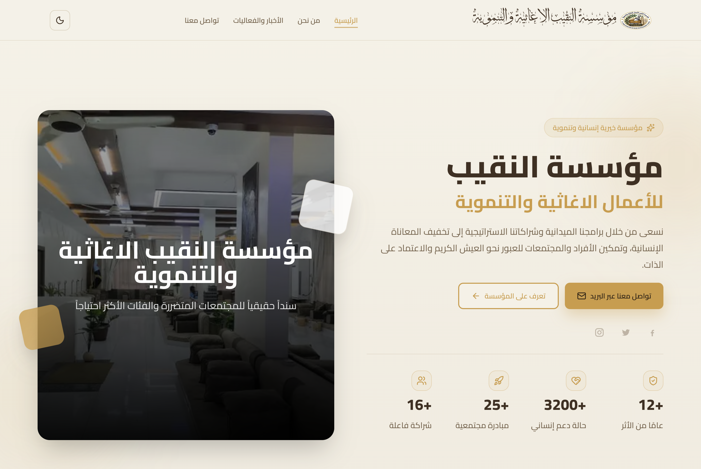
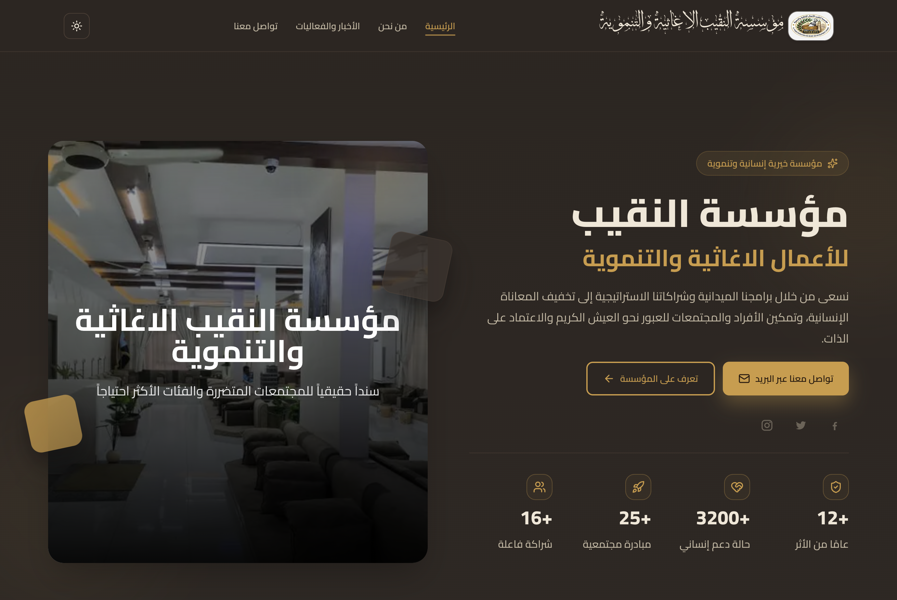
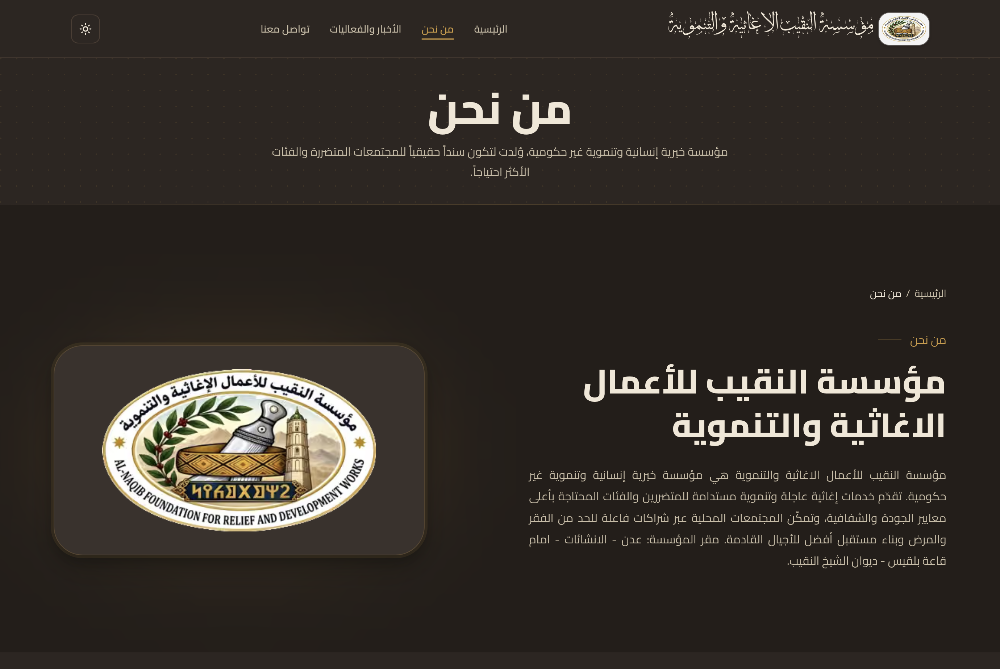
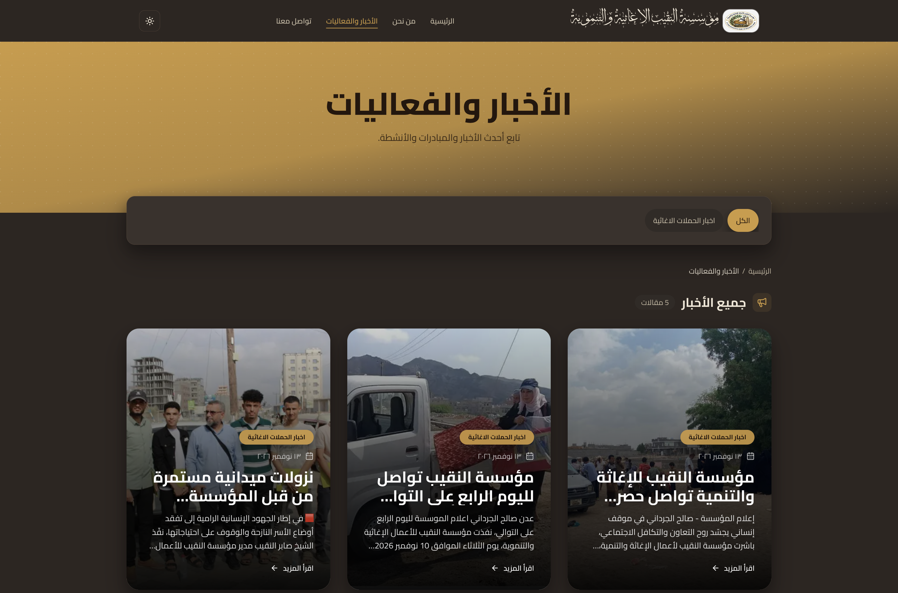
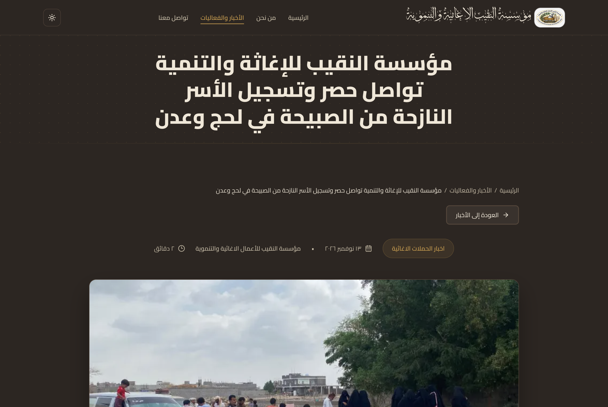
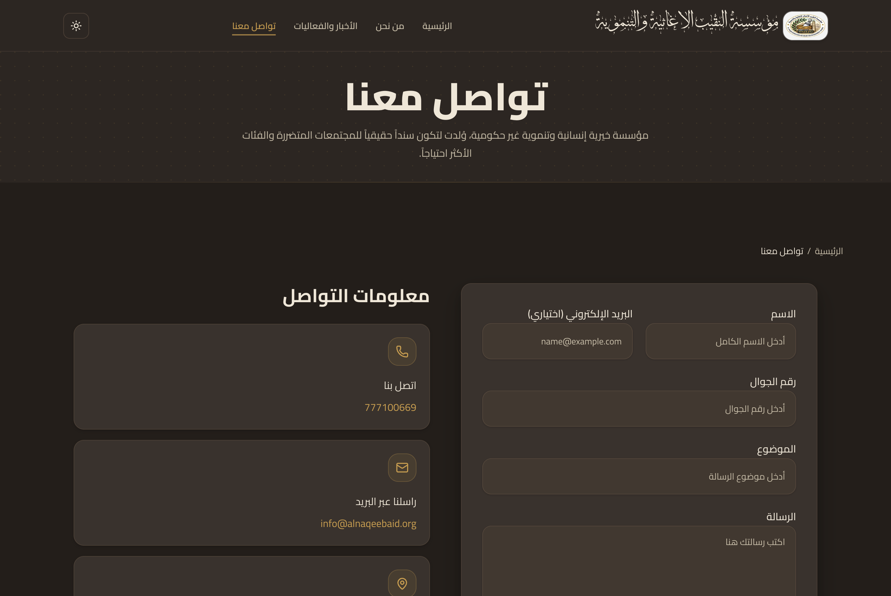

# Al-Naqeeb Foundation — Official Website

An Arabic RTL organizational website and content-managed news platform developed for **مؤسسة النقيب للأعمال الاغاثية والتنموية** (Al-Naqeeb Foundation for Relief and Development Works).

**Live Website:** [alnaqeebaid.org](https://alnaqeebaid.org/)  
**Project Type:** Organizational Website, News Platform & CMS  
**Framework:** Next.js  
**Language:** TypeScript  
**Styling:** Tailwind CSS  
**Animation:** Framer Motion  
**CMS:** Payload CMS  
**Database:** Neon PostgreSQL  
**Media Storage:** Cloudflare R2  
**Hosting:** Vercel  
**Source Code:** Private

## Overview

The foundation needed an official Arabic website to introduce its humanitarian and development work, publish field activities and news, present partners and impact, and give visitors a clear way to get in touch.

A key requirement was that non-technical staff should be able to manage website content without editing code. I developed the website using Next.js and integrated Payload CMS so editors can publish news, update contact details, manage media, and adjust site settings through an Arabic admin interface.

The website combines the foundation’s public identity with a practical publishing workflow, providing a central platform for its online presence and day-to-day communications.

## Features

### Homepage
- Brand-focused hero introducing the foundation and its mission.
- Impact statistics managed through the CMS.
- About introduction with vision, mission, and values.
- Latest news highlights from published articles.
- Partners section showcasing partner logos.

### About Us
Provides visitors with information about the foundation, its identity, values, and organizational goals.

### News and Events
- Displays published news and field activities.
- Provides a dedicated detail page for each article.
- Supports category filtering and related articles.
- Includes social sharing for WhatsApp, Facebook, X, and Telegram.
- Allows authorized staff to manage published content through Payload CMS.

### Contact Us
Provides a contact form through which visitors can submit messages. Contact channels such as phone, email, WhatsApp, social links, address, and map location are managed from the CMS and shown when available.

### Light and Dark Themes
Supports both light and dark appearance so visitors can browse in the mode they prefer.

### Responsive Design
The website adapts its layout to desktop, tablet, and mobile screens.

## Technology Stack

- **Next.js:** Website framework and page rendering.
- **React:** User interface components.
- **TypeScript:** Application development with static typing.
- **Tailwind CSS:** Utility-first styling.
- **Framer Motion:** Animation and motion effects.
- **Payload CMS:** Content management for news, media, partners, contact settings, and submissions.
- **Neon PostgreSQL:** Hosted relational database.
- **Cloudflare R2:** Production media storage.
- **Vercel:** Production hosting.
- **Git and GitHub:** Version control and project workflow.

## Technical Highlights

### CMS-Driven Content

The website separates application code from content that staff need to update regularly. Supported content can be managed through Payload without requiring changes to the frontend source code.

This includes news articles, categories, partner logos, media uploads, contact channels, impact statistics, and contact form submissions.

### Arabic RTL Experience

The full public interface is built in Arabic with a right-to-left layout. Shared layout and UI patterns keep the homepage, about, news, and contact pages consistent across the site.

### Dynamic Homepage Sections

Published news, editable statistics, and partner logos are pulled into the homepage from the CMS, so the foundation can keep the first impression current without developer involvement.

### Content Publishing Workflow

The news section provides a publishing platform for the foundation’s activities. Each article has its own detail page, including article content, media, sharing actions, and related posts.

### Media and Performance

Campaign photography and site media are stored on Cloudflare R2 with responsive image sizes, helping the public site stay fast while editors continue uploading from the admin.

## My Contribution

I developed the website to meet the foundation’s need for a professional Arabic online presence and a content-management experience suitable for non-technical staff.

My work included:

- Building the website using Next.js, React, and TypeScript.
- Implementing the homepage, about, news, and contact experiences.
- Integrating Payload CMS with the frontend.
- Connecting CMS-managed news, partners, statistics, and contact settings to the public pages.
- Implementing article detail pages, category filtering, related articles, and social sharing.
- Developing the contact form and CMS-driven contact information.
- Styling the website with Tailwind CSS and adding motion with Framer Motion.
- Implementing light/dark themes and responsive layouts for different screen sizes.
- Setting up Neon PostgreSQL, Cloudflare R2 media storage, and Vercel production hosting.

## Screenshots

Screenshots of the live website are available in the [`screenshots/`](screenshots/) directory.

Homepage (light theme):

Homepage (dark theme):

About Us:

News listing:

News article:

Contact:

## Source Code

The source code is maintained in a private repository. This public repository documents the project, its technology stack, key features, screenshots, and my contribution without exposing private source code.

## Links

- **Live Website:** [https://alnaqeebaid.org/](https://alnaqeebaid.org/)
